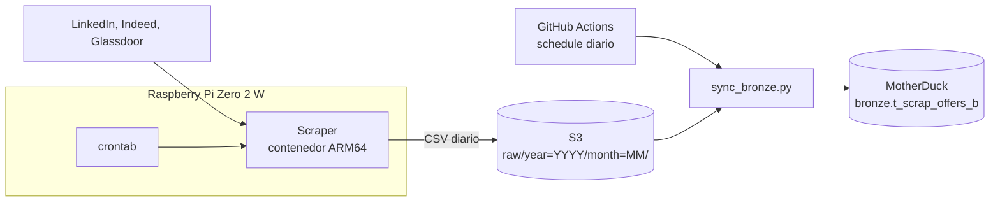

# Estudio de Mercado IT

Pipeline de datos que recoge a diario ofertas de empleo IT en España y las carga en un almacén analítico para estudiar la demanda del mercado.

**3 fuentes** (LinkedIn, Indeed, Glassdoor) · **más de 50.000 ofertas** recogidas · **100–500 ofertas nuevas al día**

## Arquitectura



- **Extracción:** un crontab en la Pi lanza el contenedor. Busca 6 perfiles en 6 ubicaciones (5 ciudades y remoto), limitado a ofertas de las últimas 24 horas.
- **Limpieza:** cada CSV se deduplica por `job_url` y por `title` + `company` + `location`.
- **Respaldo:** comprueba el acceso a S3 antes de empezar a scrapear y, al terminar, sube el CSV a una ruta particionada por año y mes.
- **Carga:** un workflow programado a las 04:00 UTC detecta en `raw/` los ficheros no cargados y los inserta en la capa bronze.
- **Trazabilidad:** cada fila incluye `extraction_date`, `source_file` e `ingested_at`.

## Decisiones técnicas

**S3 como respaldo intermedio.** Separa el scraping, que depende de portales externos y de una Pi, de la carga analítica. Si falla la carga, los CSV siguen en S3 y no hay que volver a scrapear. Además, la sincronización recorre todo `raw/`, así que también recoge ficheros que llegan tarde.

**Carga idempotente.** `source_file` registra el origen de cada fila, y los ficheros ya cargados se omiten. Repetir la sincronización no duplica datos.

**MotherDuck como almacén.** DuckDB lee los CSV directamente desde S3, de modo que la carga cabe en un script que corre en un runner de GitHub Actions, sin servidores propios.

**Bronze sin tipar.** Los datos se leen con `all_varchar` y `union_by_name`, para que un cambio de tipos o de orden de columnas en los CSV no rompa la ingesta. Las columnas nuevas no se añaden a una tabla ya creada: solo se cargan las que ya existen.

**Imagen ARM64 compilada en CI.** La Pi Zero 2 W es ARM, así que la imagen se compila con QEMU y Buildx en un runner de GitHub y la Pi solo la descarga. Por sus recursos limitados, cada búsqueda se escribe en disco de forma incremental y se llama a `gc.collect()` entre búsquedas.

**Migración desde el despliegue on-premise.** El proyecto empezó como Docker y un crontab diario en una Raspberry Pi. El crontab sigue lanzando el scraper, pero el resto ha salido de la Pi:

- Los datos se guardan en S3 y MotherDuck.
- GitHub Actions valida, compila y despliega la imagen, y programa la carga.
- Si falta el CSV del día anterior, la sincronización de prod falla y el fallo queda visible en Actions.

## CI/CD y entornos

El workflow `ci-cd-scrapper.yml` se ejecuta al hacer push a `dev` o `main` con cambios en `scrapper/` o en el propio workflow:

1. **`build-and-smoke-test`:** compila la imagen y la ejecuta con `TEST_MODE=1`. Valida `APP_ENV`, el acceso a S3 y una búsqueda real en Indeed, y falla si no se genera el CSV. No sube nada a S3.
2. **`build-arm-and-push`:** compila la imagen `linux/arm64` y la publica en GHCR con el tag del entorno y `:sha-<short>`.
3. **`deploy-raspberry`:** en un runner self-hosted, descarga la imagen y elimina las versiones huérfanas. En `dev` lanza además un scraping real; en `main` la imagen queda lista para la siguiente ejecución del crontab.

Limitación conocida: el smoke test corre sobre la imagen compilada para el runner, no sobre la ARM64, que no se ejecuta hasta llegar a la Pi.

| | dev | prod |
|---|---|---|
| Rama | `dev` | `main` |
| Imagen | `:dev` | `:prod` |
| Lanzamiento del scraper | Push a `dev` | Crontab en la Pi |
| Bucket S3 | Bucket propio con sufijo `-dev` | Bucket propio |
| Base de datos MotherDuck | `db_dev` | `db_prod` |
| Sincronización | Manual | Diaria o manual |
| Fallo si falta el CSV de ayer | No | Sí |
| Credenciales | Secrets `*_DEV` | Secrets `*_PROD` |

`APP_ENV` es obligatoria: el scraper termina con error si no vale `dev` o `prod`, lo que evita escribir en un entorno por defecto.

Los nombres de los buckets de AWS aparecen en `scrapper/src/main.py` y `.github/workflows/motherduck_sync.yml`, porque son configuración y no secretos. Las credenciales de cada entorno se guardan como secrets de GitHub, fuera del repositorio.

## Estructura del repositorio

```text
.
├── .github/workflows/
│   ├── ci-cd-scrapper.yml    # Smoke test, build ARM64, push a GHCR y despliegue
│   └── motherduck_sync.yml   # Sincronización S3 → MotherDuck, programada o manual
├── scrapper/
│   ├── Dockerfile            # Imagen del scraper (Python 3.11)
│   ├── requirements.txt      # Dependencias del scraper
│   └── src/
│       ├── main.py           # Búsquedas, deduplicación y subida
│       └── s3_uploader.py    # Comprobación de acceso y subida a S3
└── scripts/
    ├── requirements.txt      # Dependencias de la sincronización
    └── sync_bronze.py        # Carga incremental en la capa bronze
```

## Cómo ejecutarlo

Requiere Python 3.11 o Docker, y credenciales propias de AWS y MotherDuck. El scraper obtiene el bucket de la constante `BUCKET_BASE` de `main.py` y de `APP_ENV`, así que para usar otro bucket hay que cambiar esa constante.

### Variables de entorno

| Variable | Scraper | Sincronización | Notas |
|---|---|---|---|
| `APP_ENV` | Obligatoria | | `dev` o `prod` |
| `TEST_MODE` | Opcional | | `1` activa el modo smoke test |
| `AWS_ACCESS_KEY_ID` | Obligatoria | Obligatoria | |
| `AWS_SECRET_ACCESS_KEY` | Obligatoria | Obligatoria | |
| `AWS_DEFAULT_REGION` | Obligatoria | | Región para boto3 |
| `AWS_REGION` | | Obligatoria | Región del bucket |
| `ENV` | | Recomendada | Si falta, se usa `prod` |
| `S3_BUCKET` | | Obligatoria | Bucket de origen |
| `MOTHERDUCK_TOKEN` | | Obligatoria | |
| `MOTHERDUCK_DB` | | Opcional | Por defecto, `db_<ENV>` |

Guárdalas en un fichero `.env` en la raíz del repositorio (está en `.gitignore`).

### En local

```bash
python3.11 -m venv venv && source venv/bin/activate
set -a; source .env; set +a

# Scraper: TEST_MODE=1 hace una búsqueda mínima y no sube nada a S3
pip install -r scrapper/requirements.txt
TEST_MODE=1 python scrapper/src/main.py

# Sincronización con MotherDuck
pip install -r scripts/requirements.txt
python scripts/sync_bronze.py
```

### Con Docker

```bash
docker build -t scrapper ./scrapper

# Smoke test
docker run --rm --env-file .env -e TEST_MODE=1 scrapper

# Ejecución completa: conserva el CSV en ./scraps
docker run --rm --env-file .env -v "$PWD/scraps:/app/scraps" scrapper
```

## Próximos pasos

Planificado, todavía no implementado:

- **Transformaciones con dbt** a partir de bronze, que hoy está sin tipar y solo se deduplica dentro de cada CSV.
- **Orquestación con Airflow** del flujo completo.
